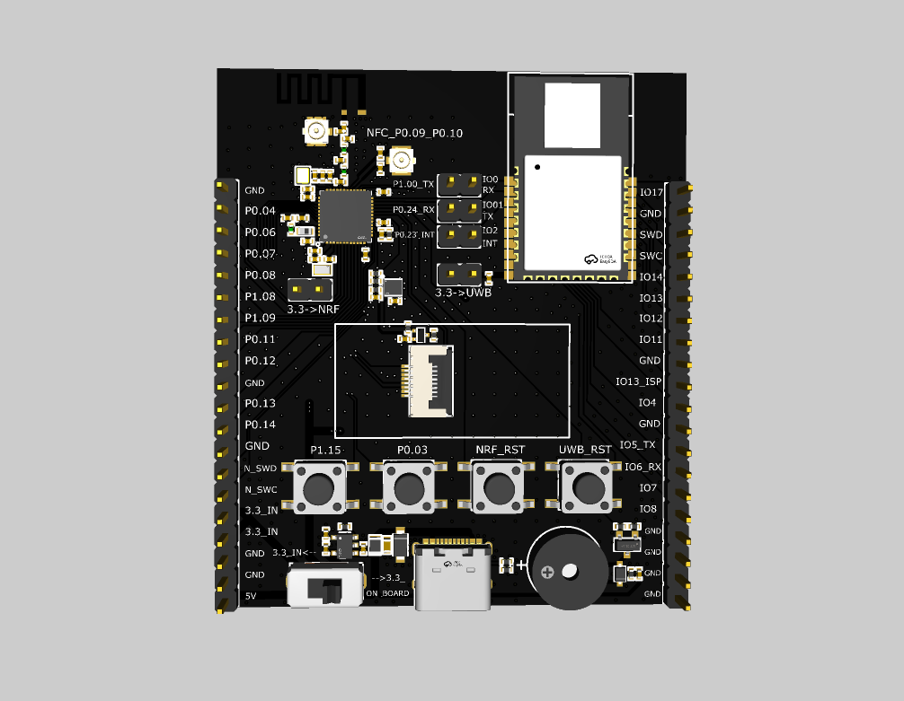

# Geezpai Spot — BLE + UWB 开源开发平台

[](LICENSE)
[](https://github.com/nrfconnect/sdk-nrf)
[](doc/)

**Geezpai Spot** 是深圳极智派科技开源的一款 BLE + UWB 融合开发板。基于 Nordic nRF52840 主控和 MQ-MMK00X UWB 模组，支持 **Google Find Hub Network (FHN) 定位** 和 **UWB 精密测距**，同时板载 TFT 彩屏、G-Sensor、蜂鸣器，适合防丢标签、室内定位、IoT 终端等产品开发。



---

## 硬件概览

| 组件 | 型号 | 说明 |
|------|------|------|
| **主控** | nRF52840-QFAA | Cortex-M4F @ 64MHz, 1MB Flash, 256KB RAM, BLE 5.0 |
| **UWB 模组** | MQ-MMK00X | IEEE 802.15.4z, CH5/9, UART @ 921600bps |
| **显示屏** | 0.96" TFT ST7735R | 80×160 RGB565, SPI 4-wire, 可拆卸 |
| **传感器** | DA217 G-Sensor | I2C @ 0x27, 双中断 |
| **蜂鸣器** | 3V 有源 | PWM 驱动 (P0.22) |
| **按键** | KEY1 + KEY2 + RESET + UWB_RESET | — |
| **供电** | USB Type-C / 电池 | 双电源域独立测流 |
| **天线** | PCB 天线 / IPEX 可选 | — |

📖 完整硬件参考：[Geezpai Spot 开发板说明](doc/Geezpai_Spot_开发板说明.md)
📖 开发文档索引：[doc/README.md](doc/README.md)

---

## 快速开始

### 1. 安装 nRF Connect SDK v3.3.0

推荐使用 **nRF Connect for Desktop** 的 Toolchain Manager 一键安装 NCS v3.3.0。

构建脚本会自动检测以下路径（也可手动设置环境变量 `ZEPHYR_BASE` 和 `ZEPHYR_SDK_INSTALL_DIR`）：

| 路径 | 说明 |
|------|------|
| `C:\ncs\v3.3.0\zephyr` | Zephyr RTOS (NCS 默认路径) |
| `C:\ncs\toolchains\<hash>\opt\zephyr-sdk` | ARM 工具链 (NCS 默认路径) |

### 2. 克隆仓库

```bash
git clone git@github.com:geezpai/geezpai-spot.git
cd geezpai-spot
```

### 3. 配置密钥（仅 FHN 定位功能需要）

```bash
cp Kconfig.sysbuild.template Kconfig.sysbuild
# 编辑 Kconfig.sysbuild，填入 Google 分配的 Model ID 和 Anti-Spoofing Key
```

> ⚠️ `Kconfig.sysbuild` 包含客户密钥，已加入 `.gitignore`，不会提交到仓库。

### 4. 编译

```bash
# === 主力固件 (Fast Pair + FHN + UWB + LCD) ===
./build.ps1

# === 基础示例 ===
cd examples/01_basics/hello_world
west build -b nrf52840dk/nrf52840 -d build

cd examples/01_basics/blinky
west build -b nrf52840dk/nrf52840 -d build

# === 完整定位标签 (从示例目录) ===
cd examples/05_findmy/locator_tag
west build -b nrf52840dk/nrf52840 -d build
```

构建结果对比：

| 模块 | 构建命令 | FLASH | RAM |
|------|---------|-------|-----|
| 主力固件 | `./build.ps1` | 311 KB | 61 KB |
| hello_world | `west build ... hello_world` | 30 KB | 8.5 KB |
| blinky | `west build ... blinky` | 33 KB | 8.7 KB |
| locator_tag | `west build ... locator_tag` | 311 KB | 61 KB |

### 5. 烧录

```bash
# J-Link 烧录 (主力固件用 sysbuild 多镜像)
west flash -d build

# 或使用脚本
./download_jlink.bat
```

### 6. 查看串口日志

波特率 **115200 8N1**，TX = P0.13, RX = P0.14。预期输出：

```
[00:00:00.000,000] <inf> fp_fhn: Starting Geezpai Spot
[00:00:00.500,000] <inf> fp_fhn: Bluetooth initialized
[00:00:01.000,000] <inf> fp_fhn: Settings loaded
[00:00:02.000,000] <inf> app_uwb: UWB initialized: bus=0 id=1
```

---

## 软件架构

```
┌─────────────────────────────────────────────────────┐
│               Geezpai Spot Firmware                  │
│  (Fast Pair Locator Tag + UWB Ranging + Display)    │
├─────────────────────────────────────────────────────┤
│  FHN (Google) │ UWB (UCI)  │  UI  │  Power Mgmt   │
├─────────────────────────────────────────────────────┤
│  LCD (ST7735) │ G-Sensor (DA217) │ Buzzer │ Button  │
├─────────────────────────────────────────────────────┤
│          nRF Connect SDK + Zephyr RTOS               │
│   BLE  │  SPI  │  I2C  │  UART  │  GPIO  │  PWM     │
└─────────────────────────────────────────────────────┘
```

详细架构和模块设计见 [开发文档索引](doc/README.md)。

---

## 功能特性

- ✅ **Google Fast Pair** — 一键配网，兼容 Android Find Hub app
- ✅ **Find Hub Network (FHN)** — 众包定位网络，全球覆盖
- ✅ **UWB 通信** — UCI 协议栈 (UART)，支持 DEVICE_RESET / GET_INFO / GET_CAPS
- 🚧 **UWB 测距** — TWR 双向测距 (API 开发中)
- ✅ **TFT 显示** — ST7735R 80×160 彩屏，支持仪表盘 UI
- ✅ **运动检测** — DA217 G-Sensor，支持 DULT 防跟踪
- ✅ **蜂鸣器响铃** — FHN 远程响铃 + 开机自检旋律
- ✅ **电池检测** — ADC 电压采集
- ✅ **DFU 升级** — MCUboot + SMP BLE OTA
- ✅ **工厂复位** — 按键触发 + FHN 自动复位

---

## 目录结构

```
geezpai-spot/
├── src/               # 应用层源码
│   ├── main.c         # 主入口 + FHN 初始化
│   ├── lcd.c          # ST7735R 显示驱动
│   ├── buzzer.c       # 蜂鸣器 PWM 驱动
│   ├── ranging.c      # BLE CS 精密测距 (需 nRF54 系列)
│   ├── uwb/           # UWB UCI 协议栈适配层
│   ├── battery/       # 电池管理 (模拟/真实)
│   ├── motion_detector/ # 运动检测 (DA217/ADXL36x)
│   ├── ui/            # UI 框架 (按键/LED/LCD/蜂鸣器)
│   ├── dfu.c          # 固件升级
│   └── factory_reset.c # 恢复出厂
├── include/           # 公共 API 头文件
├── configuration/     # Kconfig + Devicetree 配置
│   ├── prj.conf       # Debug 构建配置
│   ├── prj_release.conf # Release 构建配置
│   └── boards/        # 多板 Devicetree overlay
├── sysbuild/          # 多镜像构建 (MCUboot + App)
├── doc/               # 项目文档
├── hw/                # 硬件设计文件 (原理图/PCB/BOM)
└── tools/             # 构建/烧录脚本
```

---

## 支持的开发板

| 板子 | 目标 | FHN | UWB | 说明 |
|------|------|-----|-----|------|
| **Geezpai_Spot-v1.0** | `nrf52840dk_nrf52840` | ✅ | ✅ | 主开发板 |
| nRF52840 DK | `nrf52840dk_nrf52840` | ✅ | ❌ | 无 UWB 模组 |
| nRF52833 DK | `nrf52833dk_nrf52833` | ✅ | ❌ | — |
| nRF52832 DK | `nrf52dk_nrf52832` | ✅ | ❌ | — |
| nRF5340 DK | `nrf5340dk_nrf5340_cpuapp` | ✅ | ❌ | — |
| Thingy:53 | `thingy53_nrf5340_cpuapp` | ✅ | ❌ | 参考设计板 |
| nRF54L15 DK | `nrf54l15dk_nrf54l15_cpuapp` | ✅ | ❌ | 支持 BLE CS |
| nRF54L15 TAG | `nrf54l15tag_nrf54l15_cpuapp` | ✅ | ❌ | 支持 BLE CS |

> 非 Geezpai Spot 板子仅运行 FHN 功能，UWB 功能需要外接 MQ-MMK00X。

---

## 开发指南

- 📖 [开发板使用说明](doc/Geezpai_Spot_开发板说明.md) — 引脚映射、跳线配置、供电说明
- 📖 [开发指南](../doc/Geezpai_Spot_开发指南.md) — 环境搭建、模块开发、构建烧录
- 📖 [开发文档索引](doc/README.md) — 全部文档、数据手册、已知问题
- 📖 [SDK 规划](../doc/SDK_规划.md) — 架构设计、模块评估、路线图 (内部)
- 🐛 已知问题：DA217 G-Sensor 运动中断偶发不触发

---

## 贡献

欢迎通过 Issue 和 Pull Request 参与贡献！

### 分支策略

```
main          ← 稳定版本
├── dev       ← 日常开发
├── feature/* ← 新功能
└── fix/*     ← Bug 修复
```

### 提交前检查

```bash
# pre-commit hook 已配置，会自动检查敏感文件
git config core.hooksPath .githooks
```

---

## 许可协议

- 本项目基于 Nordic Semiconductor 的 [Fast Pair Locator Tag](https://github.com/nrfconnect/sdk-nrf) sample 开发
- 原 Nordic 代码使用 **LicenseRef-Nordic-5-Clause**
- Geezpai 原创代码使用相同协议
- MQ-MMK00X UWB UCI 协议栈为 **MKSEMI 闭源二进制**，仅提供头文件和静态库

---

## 联系方式

- **公司**: 深圳极智派科技有限公司 (Shenzhen Geezpai Technology Co., Ltd.)
- **作者**: [avery.ling@geezpai.com](mailto:avery.ling@geezpai.com)
- **GitHub**: [github.com/geezpai/geezpai-spot](https://github.com/geezpai/geezpai-spot)

---

> 🚀 **Geezpai Spot** — 让每一件物品都能被找到。
