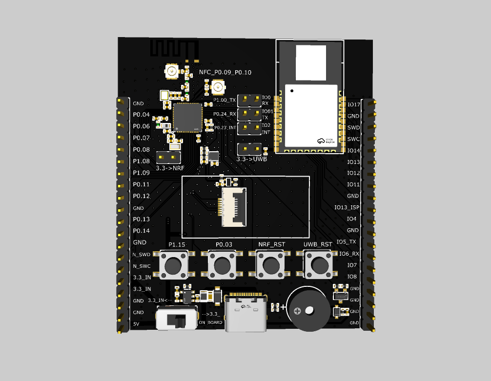

# Geezpai Spot v1.0 规格书

> BLE + UWB 融合开发板 | 适用于防丢标签、室内定位、IoT 终端

---

## 1. 产品概述

Geezpai Spot 是一款集成 BLE 5.0 和 UWB 精密测距的开源开发板。基于 Nordic nRF52840 主控和 MQ-MMK00X UWB 模组，支持 Google Find Hub Network (FHN) 和 Apple Find My 防丢定位，板载 TFT 彩屏、G-Sensor、蜂鸣器，可快速构建防丢标签、室内定位基站等产品原型。

---

## 2. 硬件规格

### 2.1 核心芯片

| 芯片 | 型号 | 规格 |
|------|------|------|
| **主控** | Nordic nRF52840-QFAA | Cortex-M4F @ 64MHz, 1MB Flash, 256KB RAM |
| **UWB 模组** | MQ-MMK00X | IEEE 802.15.4z, CH 2/5/9, 54Mbps, UCI 1.0 |
| **显示驱动** | ST7735R | 0.96" TFT, 80×160, RGB565, SPI 4-wire |
| **加速度计** | DA217 | 3-axis, I2C @ 0x27, 双中断输出 |
| **LDO** | SGM2019 | 3.3V 输出, 最大 300mA |

### 2.2 无线

| 参数 | 规格 |
|------|------|
| **BLE** | 5.0, 2.4GHz, max +8dBm, 兼容 Bluetooth Mesh |
| **UWB** | IEEE 802.15.4z, CH 2/5/9, 54Mbps, FiRa UCI 1.0 |
| **NFC** | NFC-A Tag, 13.56MHz, 焊盘引出 |
| **天线** | 板载 PCB 天线 + IPEX 焊盘 (S1/S2 电阻切换) |

### 2.3 显示

| 参数 | 规格 |
|------|------|
| **类型** | TFT 彩色液晶 |
| **尺寸** | 0.96 英寸 |
| **分辨率** | 80 × 160 (RGB565) |
| **接口** | SPI 4-wire (SCK/MOSI/MISO/CS), max 16MHz |
| **控制** | DC (RS), RST, BL (背光 PWM) |
| **连接** | 8-pin 0.5mm FPC 座 (可插拔) |

### 2.4 传感器

| 参数 | 规格 |
|------|------|
| **型号** | DA217 三轴加速度计 |
| **接口** | I2C 400kHz, 地址 0x27 |
| **量程** | ±2g / ±4g / ±8g / ±16g 可配置 |
| **中断** | INT1 引出至 P0.31, 支持 motion/wakeup/tap |

### 2.5 音频

| 参数 | 规格 |
|------|------|
| **类型** | 3V 有源电磁蜂鸣器 |
| **驱动** | N-MOSFET 低边开关, PWM0 (P0.22) |
| **音量** | PWM 占空比可调 |
| **频率** | 支持 PWM 音调控制 |

### 2.6 电源

| 参数 | 规格 |
|------|------|
| **输入** | USB Type-C 5V / 电池 2-pin 2.54mm |
| **选择** | SW2 三位滑动开关 (USB / BAT / OFF) |
| **电源域** | 双域独立 — 3.3V_nRF + 3.3V_UWB |
| **UWB 供电** | J9 跳线选择: 板载 / 外部 |
| **电池检测** | ADC (P0.28/AIN4), 分压采样 |
| **功耗测量** | 各电源域预留电流串联跳线 |

典型功耗：

| 模式 | 电流 |
|------|------|
| nRF52840 System OFF | ~0.4 μA |
| nRF52840 BLE 广播 (1s 间隔) | ~30 μA avg |
| UWB TX | ~64 mA |
| UWB RX | ~40 mA |
| UWB Sleep | ~8 μA |

### 2.7 物理规格

| 参数 | 规格 |
|------|------|
| **PCB 版本** | Geezpai_Spot-v1.0 |
| **尺寸** | 待补充 |
| **重量** | 待补充 |
| **工作温度** | -20°C ~ 70°C |
| **连接器** | USB Type-C, J6/J8 2.54mm 20-pin 排针 |

---

## 3. IO 分配

### 3.1 功能引脚

| nRF Pin | GPIO | 功能 |
|---------|------|------|
| 13 | P0.13 | Console UART TX (115200 8N1) |
| 14 | P0.14 | Console UART RX |
| 15 | P0.17 | I2C0 SDA (DA217) |
| 18 | P0.19 | I2C0 SCL (DA217) |
| 19 | P0.20 | LCD SPI SCK |
| 20 | P0.21 | LCD SPI MOSI |
| 21 | P0.22 | 蜂鸣器 PWM0 |
| 22 | P0.23 | UWB_INT 中断输入 |
| 23 | P0.24 | UWB UART RX (921600bps) |
| 24 | P1.00 | UWB UART TX (921600bps) |
| 26 | SWDIO | BLE SWD 调试 |
| 27 | SWDCLK | BLE SWD 调试 |
| 29 | P0.09 | NFC1 天线焊盘 |
| 30 | P0.10 | NFC2 天线焊盘 |
| 38 | P1.15 | 用户按键 KEY1 (S3) |
| 39 | P0.03 | 用户按键 KEY2 (S4) |
| 40 | P0.02 | LCD RST 复位 |
| 41 | P0.28 | LCD RS + 电池 ADC |
| 42 | P0.29 | LCD CS 片选 |
| 43 | P0.30 | LCD BL 背光 |
| 44 | P0.31 | G-Sensor INT1 |

> ⚠️ P0.28-P0.31 为 LF-IO (≤10kHz)。QFAA 封装无 USB D+/D-。

### 3.2 扩展排针 — J6 (BLE)

| Pin | 信号 | Pin | 信号 |
|-----|------|-----|------|
| 1 | P0.04 | 2 | P0.05 |
| 3 | P0.07 | 4 | P1.08 |
| 5 | P1.09 | 6 | P0.11 |
| 7 | P0.13 (TX) | 8 | P0.14 (RX) |
| 9 | GND | 10 | — |
| 11 | P0.17 (SDA) | 12 | P0.19 (SCL) |
| 13 | GND | 14 | SWDCLK |
| 15 | SWDIO | 16 | 3.3V_IN |
| 17 | GND | 18 | 5V |
| 19 | P0.28 | 20 | GND |

### 3.3 扩展排针 — J8 (UWB)

| Pin | 信号 | Pin | 信号 |
|-----|------|-----|------|
| 1 | GPIO_17 / RESET | 2 | GND |
| 3 | SWDIO | 4 | SWCLK |
| 5 | SPI_CS | 6 | SPI_CLK |
| 7 | SPI_MISO | 8 | SPI_MOSI |
| 9 | GPIO_03 (ISP) | 10 | NC |
| 11 | GPIO_04 (ISP) | 12 | DBG_TX |
| 13 | DBG_RX | 14 | GPIO_07 |
| 15 | GPIO_08 | 16 | NC |
| 17 | 3.3V_UWB | 18 | NC |
| 19 | GND | 20 | NC |

---

## 4. 调试接口

| 接口 | 信号 | 引出位置 |
|------|------|---------|
| **BLE SWD** | SWDCLK, SWDIO, RESET | J6 Pin14-15, S5 按键 |
| **UWB SWD** | SWDCLK, SWDIO, RESET | J8 Pin3-4, S6 按键 |
| **Console UART** | TX(P0.13), RX(P0.14) | J6 Pin7-8, 115200 8N1 |
| **UWB UART** | TX(P1.00), RX(P0.24) | J4/J5 跳线, 921600 8N1 |

---

## 5. 跳线配置

| 跳线 | 功能 | 默认 |
|------|------|------|
| **SW2** | 供电选择: USB / 电池 / OFF | — |
| **J4** | UWB UART RX 连通/断开 | 短接 |
| **J5** | UWB UART TX 连通/断开 | 短接 |
| **J7** | UWB INT 连通/断开 | 短接 |
| **J9** | UWB 供电: 板载 / 外部 | 板载(短接) |
| **S1/S2** | 天线: PCB / IPEX | PCB |

---

## 6. 软件支持

| 项目 | 说明 |
|------|------|
| **SDK** | nRF Connect SDK v3.3.0 (Zephyr RTOS) |
| **构建** | west build / build.ps1 |
| **烧录** | J-Link SWD / nrfjprog |
| **定位协议** | Google FHN (Find Hub Network) |
| **UWB 协议** | FiRa UCI 1.0 |
| **固件** | [github.com/geezpai/geezpai-spot](https://github.com/geezpai/geezpai-spot) |
| **硬件** | [github.com/geezpai/geezpai-spot/tree/main/doc](https://github.com/geezpai/geezpai-spot/tree/main/doc) (原理图/IO Map/数据手册) |
| **示例** | [github.com/geezpai/geezpai-spot/tree/main/examples](https://github.com/geezpai/geezpai-spot/tree/main/examples) |

---

## 7. 包装清单

| 项目 | 数量 |
|------|------|
| Geezpai Spot 主板 | 1 |
| 0.96" TFT 屏模块 | 1 |
| 2.54mm 排针 | 选配 |

---

## 8. 订购信息

| 型号 | 说明 |
|------|------|
| **Geezpai Spot v1.0** | BLE + UWB 开发板, 板载 TFT/G-Sensor/蜂鸣器 |

---

> **深圳极智派科技有限公司** | 固件开源: [github.com/geezpai/geezpai-spot](https://github.com/geezpai/geezpai-spot) | 联系: avery.ling@geezpai.com
