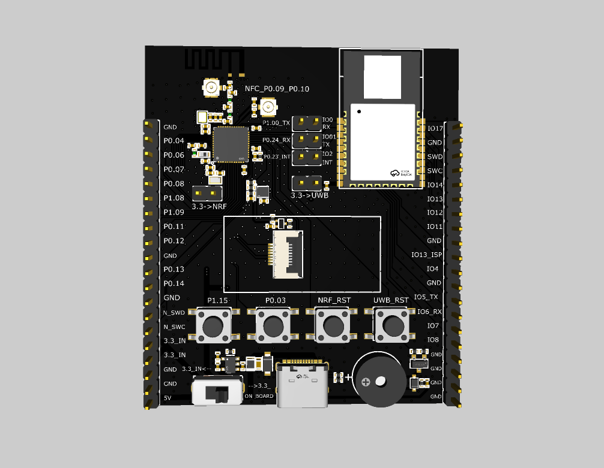

# Geezpai Spot — BLE + UWB 开发板使用说明

> **硬件版本：** Geezpai_Spot-v1.0
> **原理图：** `Geezpai_Spot-v1.0.pdf`
> **主控：** Nordic nRF52840-QFAA (Cortex-M4F @ 64MHz, 1MB Flash, 256KB RAM)
> **UWB：** MQ-MMK00X 系列模组 (MK8000 + SW8112Q/SW8110Q FEM)
> **显示：** 0.96 寸 TFT SPI 彩色屏 (ST7735R, 80×160, 8-pin 0.5mm FPC)
> **定位技术：** Google Fast Pair / FHN / UWB
> **固件源码：** [github.com/geezpai/geezpai-spot](https://github.com/geezpai/geezpai-spot)
> **公司：** 深圳极智派科技有限公司 (Shenzhen Geezpai Technology Co., Ltd.)
> **作者：** avery.ling@geezpai.com

---

## 1. 系统总览

### 1.1 PCB 实物



### 1.2 功能框图

```
┌──────────────────────────────────────────────────────────────┐
│                     Geezpai_Spot-v1.0                       │
│                                                              │
│  ┌──────────┐        SW2 供电选择        ┌──────────────┐    │
│  │USB Type-C│──┐         ┌──────────────→│   3.3V_nRF   │    │
│  └──────────┘  ├─────────┤               │  (主板域)     │    │
│  ┌──────────┐  │         │               ├──────────────┤    │
│  │ 电池 J2  │──┘    ┌────┴────┐          │ nRF52840     │    │
│  └──────────┘       │  SGM2019 │          │ TFT屏(SPI)   │    │
│                     │  LDO     │          │ G-Sensor(I2C)│    │
│                     └────┬────┘          │ 蜂鸣器(PWM)  │    │
│                          │               │ 按键×4       │    │
│                          │ J9 跳线        │ J6扩展排针   │    │
│                          ├──────────────→├──────────────┤    │
│                          │               │   3.3V_UWB   │    │
│                          │               │  (UWB独立域) │    │
│                          │               ├──────────────┤    │
│                          │               │ MQ-MMK00X    │    │
│                          │               │ J8扩展排针   │    │
│                          │               └──────────────┘    │
│                                                              │
│  nRF52840 ←──UART (921600bps, J4/J5跳线)──→ UWB             │
│  nRF52840 ←──INT  (J7跳线)───────────────→ UWB             │
│  nRF52840 ────RESET──────────────────────→ UWB             │
│  nRF52840 ────UART0 (115200bps)──────────→ 调试串口(Console) │
└──────────────────────────────────────────────────────────────┘
```

### 1.3 板载资源一览

| 资源 | 说明 |
|------|------|
| **主控** | nRF52840-QFAA, Cortex-M4F 64MHz, BLE 5.0, NFC-A |
| **UWB** | MQ-MMK00X, IEEE 802.15.4z, CH2/5/9, 54Mbps |
| **显示** | 0.96" TFT ST7735R, 80×160 RGB565, SPI 4-wire |
| **传感器** | G-Sensor DA217, I2C 地址 0x27, 双中断 |
| **蜂鸣器** | 3V 有源蜂鸣器, PWM 驱动 (P0.22) |
| **按键** | KEY1(P1.15), KEY2(P0.03), RESET, UWB_RESET |
| **USB** | Type-C 供电 + nRF52840 USB 数据 |
| **电池** | 2-pin 2.54mm, ADC 电压检测 (P0.28/AIN4) |
| **天线** | PCB 天线 + IPEX 焊盘可选 (S1/S2) |
| **NFC** | P0.09/P0.10 引出 NFC 天线焊盘 |
| **调试** | Console UART (P0.13/P0.14) + BLE SWD + UWB SWD |
| **扩展** | J6 (BLE 20-pin) + J8 (UWB 20-pin) |

> ⚠️ **QFAA 注意：** P0.28–P0.31 仅低频 IO (≤10kHz)。QFAA 无 USB D+/D-。

---

## 2. 供电

### 2.1 供电方式

| 方式 | 操作 |
|------|------|
| **USB 供电** | SW2 → USB, J1 Type-C 接 5V |
| **电池供电** | SW2 → BAT, J2 接电池 |
| **UWB 外部供电** | J9 跳线帽拔掉, 外部 3.3V 接 J8 Pin 17 |

### 2.2 供电选择

| 位号 | 类型 | 功能 | 默认 |
|------|------|------|------|
| **SW2** | 3位滑动 | USB / 电池 / OFF | — |
| **J9** | 2-pin 跳线 | UWB 供电: 板载 / 外部 | **板载 (短接)** |

### 2.3 电源域

| 电源轨 | 电压 | 供电对象 | 测试位置 |
|--------|------|---------|---------|
| **5V** | 5V | USB 输入 | J6 Pin 18 |
| **3.3V_nRF** | 3.3V | nRF52840 + TFT + G-Sensor + 蜂鸣器 | LDO 输出 |
| **3.3V_UWB** | 3.3V | MQ-MMK00X | J9, J8 Pin 17 |

### 2.4 功耗参考

| 芯片 | 模式 | 典型电流 |
|------|------|---------|
| nRF52840 | BLE 广播 (1s) | ~30μA avg |
| nRF52840 | System OFF | ~0.4μA |
| UWB | TX | ~64mA |
| UWB | RX | ~40mA |
| UWB | Sleep | ~8μA |

---

## 3. nRF52840 IO 完整分配 (以固件 app_board_pins.h 为准)

### 3.1 功能引脚映射表

| nRF Pin | GPIO | 功能 | 连接目标 |
|---------|------|------|---------|
| 2 | P0.00/XL1 | 32.768KHz RTC 晶振 | — |
| 3 | P0.01/XL2 | 32.768KHz RTC 晶振 | — |
| 13 | **P0.13** | **Console UART TX (调试串口)** | 引出, 115200bps |
| 14 | **P0.14** | **Console UART RX (调试串口)** | 引出, 115200bps |
| 15 | **P0.17** | **I2C0 SDA (G-Sensor DA217)** | DA217 @ 0x27 |
| 16 | P0.18/RESET | nRF52840 复位 | S5 按键 |
| 18 | **P0.19** | **I2C0 SCL (G-Sensor DA217)** | DA217 @ 0x27 |
| 19 | **P0.20** | **LCD SPI SCK** | TFT ST7735R |
| 20 | **P0.21** | **LCD SPI MOSI** | TFT ST7735R |
| 21 | **P0.22** | **蜂鸣器 BEEP (PWM0)** | MOS 管栅极, 高电平响 |
| 22 | **P0.23** | **UWB_INT (中断输入)** | → J7 → UWB Pin 3 |
| 23 | **P0.24** | **UWB UART RX** | ← UWB Pin 2 (经 J4), 921600bps |
| 24 | **P1.00** | **UWB UART TX** | → UWB Pin 1 (经 J5), 921600bps |
| 26 | SWDIO | BLE SWD 数据 | J6 + 调试焊盘 |
| 27 | SWDCLK | BLE SWD 时钟 | J6 + 调试焊盘 |
| 29 | P0.09/NFC1 | NFC 天线 | 焊盘引出 |
| 30 | P0.10/NFC2 | NFC 天线 | 焊盘引出 |
| 35 | XC1 | 32MHz 主晶振 | — |
| 36 | XC2 | 32MHz 主晶振 | — |
| 38 | **P1.15** | **用户按键 KEY1 (Button0)** | S3, 低有效, 内部上拉 |
| 39 | **P0.03** | **用户按键 KEY2 (Button1)** | S4, 低有效, 内部上拉 |
| 40 | **P0.02** | **LCD RST (硬件复位)** | TFT RESET, 低有效 |
| 41 | **P0.28/AIN4** | **LCD RS (寄存器选择)** + **电池 ADC** | TFT DC + 电池分压 ⚠️ LF-IO |
| 42 | **P0.29/AIN5** | **LCD CS (片选)** | TFT CS, 低有效 ⚠️ LF-IO |
| 43 | **P0.30/AIN6** | **LCD BL (背光)** | TFT LEDA, GPIO 控制 ⚠️ LF-IO |
| 44 | **P0.31/AIN7** | **G-Sensor INT1 (中断)** | DA217 INT1 ⚠️ LF-IO |

### 3.2 引出至 J6 排针的保留 GPIO

| nRF Pin | GPIO | 备注 |
|---------|------|------|
| 4 | P0.04/AIN2 | 保留, 可作 ADC/GPIO (亦可用作 Button2) |
| 5 | P0.05/AIN3 | 保留, 可作 ADC/GPIO (亦可用作 Button3) |
| 6 | P0.07 | 保留 GPIO |
| 8 | P1.08 | 保留 GPIO |
| 9 | P1.09 | 保留 GPIO |
| 10 | P0.11 | 保留 GPIO |
| 11 | P0.12 | LCD SPI MISO (loopback), 保留 GPIO |

### 3.3 功能分组速查

| 功能组 | GPIO | 外设实例 | 参数 |
|--------|------|---------|------|
| **Console UART** | P0.13(TX), P0.14(RX) | UART0 | 115200 8N1 |
| **UWB UART** | P1.00(TX), P0.24(RX) | UART1 | 921600 8N1 |
| **UWB 控制** | P0.23(INT) | GPIO | 中断输入 |
| **LCD SPI** | P0.20(SCK), P0.21(MOSI), P0.12(MISO) | SPI2 | 16MHz |
| **LCD 控制** | P0.02(RST), P0.28(RS), P0.29(CS), P0.30(BL) | GPIO | — |
| **I2C (G-Sensor)** | P0.17(SDA), P0.19(SCL) | I2C0 (TWI) | 400kHz, DA217 @ 0x27 |
| **G-Sensor INT** | P0.31(INT1) | GPIO | 中断输入 |
| **蜂鸣器** | P0.22 | PWM0 | — |
| **按键** | P1.15(KEY1), P0.03(KEY2) | GPIO | 低有效, 内部上拉 |
| **NFC** | P0.09(NFC1), P0.10(NFC2) | NFCT | 13.56MHz |

---

## 4. 显示屏接口 (0.96" TFT ST7735R 80×160)

**连接器：** U3, 8-pin 0.5mm FPC (可插拔)

| FPC Pin | 信号 | nRF GPIO | 功能 |
|---------|------|---------|------|
| 1 | VDD | 3.3V_nRF | 屏供电 |
| 2 | SCL | **P0.20** | SPI Clock |
| 3 | SDA | **P0.21** | SPI MOSI |
| 4 | RS | **P0.28** | Data/Command |
| 5 | RESET | **P0.02** | 硬件复位 (低有效) |
| 6 | GND | GND | 地 |
| 7 | LEDA | **P0.30** | 背光 (GPIO 高=ON) |
| 8 | CS | **P0.29** | 片选 (低有效) |

> 屏驱动 IC 为 ST7735R, SPI 4-wire 模式, RGB565, 实际显示区域 80×160。
> 拆下 FPC 不影响 BLE↔UWB 功能。

---

## 5. UWB 模组 (MQ-MMK00X)

### 5.1 20-Pin 完整引脚

| Pin | 信号 | GPIO | 板上连接 | 说明 |
|-----|------|------|---------|------|
| 1 | UART_RX | GPIO_00 | ← P1.00 (J5) | BLE→UWB, 921600bps |
| 2 | UART_TX | GPIO_01 | → P0.24 (J4) | UWB→BLE, 921600bps |
| 3 | GPIO_02 | GPIO_02 | → P0.23 (J7) | 中断/唤醒 ⚠️ 上电默认上拉 |
| 4 | GPIO_03 | GPIO_03 | → J8 Pin 9 | ⚠️ ISP, 上电决定启动模式 |
| 5 | GPIO_04 | GPIO_04 | → J8 Pin 11 | ISP |
| 6 | GPIO_05 | GPIO_05 | → J8 Pin 12 | 调试 UART TX |
| 7 | GPIO_06 | GPIO_06 | → J8 Pin 13 | 调试 UART RX |
| 8 | GPIO_07 | GPIO_07 | → J8 Pin 14 | GPIO |
| 9 | GPIO_08 | GPIO_08 | → J8 Pin 15 | GPIO |
| **10** | **VCC** | — | **3.3V_UWB** | 供电 2.8–3.3V |
| **11** | **GND** | — | **GND** | 地 |
| **12** | **NC** | — | **⚠️ 悬空! 禁止连接** | 模块内部保留 |
| **13** | **NC** | — | **⚠️ 悬空! 禁止连接** | 模块内部保留 |
| 14 | SPI_MOSI | GPIO_11 | → J8 Pin 8 | UWB SPI |
| 15 | SPI_MISO | GPIO_12 | → J8 Pin 7 | UWB SPI |
| 16 | SPI_CLK | GPIO_13 | → J8 Pin 6 | UWB SPI |
| 17 | SPI_CS | GPIO_14 | → J8 Pin 5 | UWB SPI |
| 18 | GPIO_15 | GPIO_15 | → J8 Pin 4 | UWB SWDCLK |
| 19 | GPIO_16 | GPIO_16 | → J8 Pin 3 | UWB SWDIO |
| 20 | GPIO_17 | GPIO_17 | ← UWB_RESET (P0.24 复用? 独立 S6) + J8 Pin 1 | 复位 |

### 5.2 BLE ↔ UWB 通信跳线

| 跳线 | 连接 | 默认 | 断开效果 |
|------|------|------|---------|
| **J4** | P0.24(RX) ↔ GPIO1_TX | **短接** | UART RX 隔离 |
| **J5** | P1.00(TX) ↔ GPIO0_RX | **短接** | UART TX 隔离 |
| **J7** | P0.23(INT) ↔ GPIO2 | **短接** | 中断隔离 |

### 5.3 UWB 复位

- **S6 按键** — 手动复位 (不依赖 BLE 固件)
- 上拉至 3.3V_nRF 确保默认不复位

---

## 6. 板载外设

### 6.1 G-Sensor (U5, DA217)

| 属性 | 值 |
|------|-----|
| I2C 总线 | I2C0 (TWI), 400kHz |
| I2C 地址 | **0x27** |
| SDA | P0.17 |
| SCL | P0.19 |
| 中断 INT1 | P0.31 (⚠️ LF-IO) |
| 工作模式 | I2C (CSB 接 3.3V) |

### 6.2 蜂鸣器

| 属性 | 值 |
|------|-----|
| 控制引脚 | P0.22 (PWM0) |
| 驱动方式 | N-MOSFET 低边开关 |
| 控制 | GPIO 高=ON, PWM 可调音量/音调 |
| 关闭 | P0.22=低 |

### 6.3 按键

| 位号 | 丝印 | 功能 | GPIO | 有效电平 |
|------|------|------|------|---------|
| **S3** | KEY1 | 用户按键 1 | **P1.15** | 按下=低 (内部上拉) |
| **S4** | KEY2 | 用户按键 2 | **P0.03** | 按下=低 (内部上拉) |
| **S5** | NRF_RESET | nRF52840 系统复位 | P0.18/RESET | 按下=低 |
| **S6** | UWB_RESET | UWB 独立复位 | UWB Pin 20 | 按下=低 |

### 6.4 NFC

| 属性 | 值 |
|------|-----|
| nRF 引脚 | P0.09 (NFC1), P0.10 (NFC2) |
| 引出 | PCB 焊盘, 可焊 NFC 线圈 |
| 注意 | 使用 NFC 时不可作 GPIO |

### 6.5 Console 调试串口

| 属性 | 值 |
|------|-----|
| TX | P0.13 |
| RX | P0.14 |
| 波特率 | 115200 8N1 |
| 用途 | 固件日志输出 / Shell |

---

## 7. 扩展排针

### 7.1 J6 — BLE IO 扩展 (2.54mm 20-pin)

| Pin | 信号 | 说明 |
|-----|------|------|
| 1 | P0.04/AIN2 | ADC/GPIO (保留) |
| 2 | P0.05/AIN3 | ADC/GPIO (保留) |
| 3 | P0.07 | GPIO (保留) |
| 4 | P1.08 | GPIO (保留) |
| 5 | P1.09 | GPIO (保留) |
| 6 | P0.11 | GPIO (保留) |
| 7 | **P0.13** | Console UART TX |
| 8 | **P0.14** | Console UART RX |
| 9 | GND | 地 |
| 10 | — | — |
| 11 | **P0.17** | I2C0 SDA (DA217) |
| 12 | **P0.19** | I2C0 SCL (DA217) |
| 13 | GND | 地 |
| 14 | **SWDCLK** | BLE 调试时钟 |
| 15 | **SWDIO** | BLE 调试数据 |
| 16 | 3.3V_IN | 外部 3.3V 注入 |
| 17 | GND | 地 |
| 18 | 5V | USB 5V 输出 |
| 19 | P0.28/AIN4 | LCD RS + 电池 ADC ⚠️ LF-IO |
| 20 | GND | 地 |

### 7.2 J8 — UWB IO 扩展 (2.54mm 20-pin)

| Pin | 信号 | 说明 |
|-----|------|------|
| 1 | GPIO_17 | UWB GPIO / RESET |
| 2 | GND | 地 |
| 3 | **GPIO_16 (SWDIO)** | UWB 调试数据 |
| 4 | **GPIO_15 (SWCLK)** | UWB 调试时钟 |
| 5 | GPIO_14 (SPI_CS) | UWB SPI CS |
| 6 | GPIO_13 (SPI_CLK) | UWB SPI CLK |
| 7 | GPIO_12 (SPI_MISO) | UWB SPI MISO |
| 8 | GPIO_11 (SPI_MOSI) | UWB SPI MOSI |
| 9 | GPIO_03 | ISP/GPIO ⚠️ |
| 10 | NC | — |
| 11 | GPIO_04 | ISP/GPIO |
| 12 | GPIO_05 (DBG_TX) | 调试 UART TX |
| 13 | GPIO_06 (DBG_RX) | 调试 UART RX |
| 14 | GPIO_07 | GPIO |
| 15 | GPIO_08 | GPIO |
| 16 | NC | — |
| 17 | **3.3V_UWB** | UWB 电源轨 |
| 18 | NC | — |
| 19 | GND | 地 |
| 20 | NC | — |

---

## 8. 调试接口

### BLE (nRF52840) SWD

| 信号 | 引出 |
|------|------|
| SWDCLK | J6 Pin 14 + 调试焊盘 |
| SWDIO | J6 Pin 15 + 调试焊盘 |
| RESET | S5 按键 |

### UWB (MK8000) SWD

| 信号 | 引出 |
|------|------|
| SWDCLK | J8 Pin 4 |
| SWDIO | J8 Pin 3 |
| RESET | S6 按键 |

### Console 串口

| 信号 | GPIO | 引出 |
|------|------|------|
| TX | P0.13 | J6 Pin 7 |
| RX | P0.14 | J6 Pin 8 |
| 参数 | 115200 8N1 | — |

---

## 9. 测试点

| 信号 | 位置 |
|------|------|
| 5V | J6 Pin 18 |
| 3.3V_nRF | LDO 输出端 |
| 3.3V_UWB | J8 Pin 17 / J9 |
| Console UART TX/RX | J6 Pin 7-8 |
| UWB UART TX/RX | J4 / J5 两端 |
| UWB_INT | J7 两端 |
| I2C SDA/SCL | J6 Pin 11-12 |
| UWB SPI | J8 Pin 5-8 |

---

## 10. 固件开发速查

### 10.1 环境与结构

| 项目 | 说明 |
|------|------|
| SDK | nRF Connect SDK (NCS) |
| Board Target | `nrf52840dk_nrf52840` + 自定义 overlay |
| 工程名 | `geezpai_spot` |
| 构建 | west build / `build.ps1` |
| 烧录 | west flash |

### 10.2 GPIO 定义 (来自 app_board_pins.h)

```c
// ===== Console UART (调试串口) =====
#define CONSOLE_TX      13      // P0.13 - UART0 TX, 115200
#define CONSOLE_RX      14      // P0.14 - UART0 RX

// ===== LCD TFT ST7735R (SPI2) =====
#define LCD_SPI_SCK     20      // P0.20
#define LCD_SPI_MOSI    21      // P0.21
#define LCD_SPI_MISO    12      // P0.12
#define LCD_CS          29      // P0.29 (低有效)
#define LCD_RS          28      // P0.28 (Data/Command)
#define LCD_RST         2       // P0.02 (低有效)
#define LCD_BL          30      // P0.30 (高=ON)

// ===== I2C0 (G-Sensor DA217 @ 0x27) =====
#define I2C_SDA         17      // P0.17
#define I2C_SCL         19      // P0.19
#define DA217_I2C_ADDR  0x27
#define GSENSOR_INT     31      // P0.31

// ===== UWB (UART1, 921600) =====
#define UWB_UART_TX     1000    // P1.00 (= NRF_GPIO_PIN_MAP(1,0))
#define UWB_UART_RX     24      // P0.24
#define UWB_INT         23      // P0.23

// ===== 外设 =====
#define BUZZER_PIN      22      // P0.22 - PWM0
#define KEY1_PIN        1015    // P1.15 (= NRF_GPIO_PIN_MAP(1,15))
#define KEY2_PIN        3       // P0.03

// ===== 保留 GPIO (J6引出, 可用) =====
// P0.04, P0.05, P0.07, P0.11, P1.08, P1.09
```

### 10.3 UWB 上电流程

```
1. UWB_RESET 拉低 10ms 复位 UWB
2. 释放复位, 等 50ms 启动
3. UART1 (P1.00/P0.24, 921600) 发送 UCI 配置命令
4. 等待 UWB_INT (P0.23) 就绪
5. 发送开始测距 → 循环接收测距结果 → 更新 LCD
```

---

## 11. 跳线配置速查

| 跳线 | 信号 | 默认 | 断开场景 |
|------|------|------|---------|
| **SW2** | 主板供电 | — | USB↔电池切换 |
| **J4** | UART RX (P0.24↔GPIO1_TX) | **短接** | 抓 UART RX 波形 |
| **J5** | UART TX (P1.00↔GPIO0_RX) | **短接** | 抓 UART TX 波形 |
| **J7** | UWB INT (P0.23↔GPIO2) | **短接** | 隔离中断调试 |
| **J9** | UWB 供电: 板载/外部 | **板载(短接)** | UWB 外部电源 |
| **S1/S2** | 天线: PCB/IPEX | **PCB** | 改焊到 IPEX |

---

> **文档版本：** V3.1 | 2026-08-01
> **产品名称：** Geezpai Spot
> **IO 映射基准：** `geezpai-spot/include/app_board_pins.h`
> **公司：** Shenzhen Geezpai Technology Co., Ltd. (深圳极智派科技有限公司)
